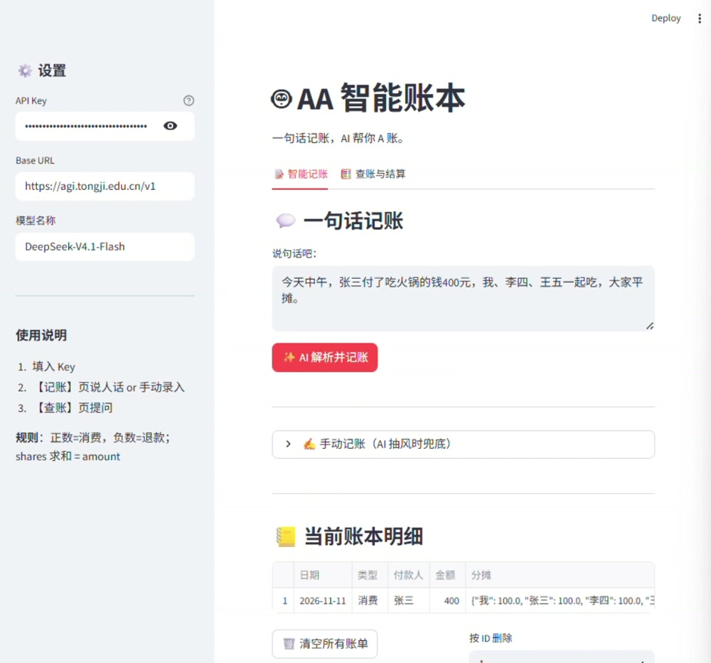

# 🤖 AA 智能账本

> 一句话记账，AI 帮你 A 账。

基于大语言模型的 AA 制智能记账与结算工具。用自然语言描述消费或退款，系统自动解析为结构化账目，校验金额一致性，并在查账时生成**债务最小化**的转账方案。

**技术栈**：Python · Streamlit · Pandas · LLM API（OpenAI 兼容接口）· 规则校验

---

## 🎬 演示视频

[](./展示视频.mp4?raw=1)

> 点击预览图播放完整演示视频。

---

## ✨ 功能亮点

### 📝 智能记账

- **自然语言解析**：输入"昨天张三付了KTV 800，李四王五赵六一起AA"，自动拆解为结构化账目。
- **消费/退款统一模型**：正数=消费，负数=退款，一套数据结构覆盖两种场景。
- **AI 幻觉防护**：对每条 AI 输出做严格校验——`shares` 求和必须等于 `amount`（误差 ≤ 0.01），禁止 `"*"`/`"所有人"` 等通配符，金额非零、付款人非空。不合规记录直接丢弃，不污染账本。
- **多笔拆分**：一句话包含多笔独立消费时，AI 自动拆成多条记录。
- **手动兜底**：AI 不可用或解析失败时，可用表单手动录入 JSON 分摊明细。

### 🧮 查账与结算

- **意图识别**：AI 只负责识别用户意图（查明细 / 查总额 / 结算 / 排行）与参数（人名、时间范围），**不参与账目筛选**，避免 AI 篡改财务数据。
- **多维度筛选**：按时间范围（如"最近一个月"→ 自动换算为日期区间）与人员过滤。
- **AA 结算**：计算每人净额（正=欠钱，负=被欠），并用**状态压缩 DP 求出转账笔数最少的结算方案**，避免"人人转人人"的冗余。
- **排行榜**：谁付钱最多（按垫付净额）、谁消费额最高（按应承担净额）。

### 🖥️ 交互

- Streamlit 双 Tab 界面：📝 智能记账 / 🧮 查账与结算
- 账本明细表格展示，支持按 ID 删除、一键清空
- API Key 在侧边栏输入，不落盘、不硬编码

---

## 🧠 核心设计

### 数据结构

每条账单是一个字典：

```json
{
  "id": 1,
  "date": "2026-11-08",
  "payer": "张三",
  "amount": 800,
  "shares": {"张三": 200, "李四": 200, "王五": 200, "赵六": 200},
  "remark": "KTV AA"
}
```

**规则**：

- `amount > 0` 表示共同消费，`amount < 0` 表示退款/冲销
- `payer` 是"钱从谁手里出去"的人：消费时是垫资人，退款时是退款人
- `shares[key]` 是该成员最终应承担的份额，**求和恒等于 `amount`**
- 约定消费时 `shares` 全正，退款时 `shares` 全负（由 Prompt 约束，代码只校验求和）

### 结算算法

1. 对每笔账单：`paid[payer] += amount`，`owe[person] += shares[person]`
2. 净额 `balance[p] = owe[p] - paid[p]`（正=欠钱，负=被欠）
3. 求最少笔数的转账方案（`min_transfers`）

**为什么不用简单贪心**：把欠钱方和被欠方各自降序排列、依次配对，只能保证笔数 ≤ 人数 - 1，不一定最少。例如净额 A+6、B+3、E+2、C-5、D-3、F-3，贪心出 5 笔，而 B→D 3 单独结清后其余 3 笔即可，最优是 4 笔。

**最优解思路**：k 个净额之和为 0 的人内部最多需要 k-1 笔转账，所以**最少笔数 = 人数 - 最多能拆出的"零和小组"数**。用子集状态压缩 DP 求这个最大小组数：

- `total[m]`：集合 m 的净额之和
- `best[m] = max(best[m 去掉一人]) + (total[m] == 0 ? 1 : 0)`

回溯出小组划分后，每个小组内部用贪心配对生成 k-1 笔转账。时间复杂度 O(2ⁿ·n)，16 人约 0.1 秒；超过 16 人时退回整体贪心。金额统一换算为"分"做整数运算，避免浮点误差。

### AI 职责边界

| 环节  | AI 负责            | 代码负责              |
| --- | ---------------- | ----------------- |
| 记账  | 从自然语言提取 JSON 数组  | 校验金额一致性、去通配符、四舍五入 |
| 查账  | 识别意图 + 人名 + 时间范围 | 筛选账目、计算净额、生成转账方案  |

AI **只做语义理解，不做财务计算**，从架构上隔离"模型幻觉"对账目正确性的影响。

---

## 🚀 快速开始

### 1. 安装依赖

```bash
pip install -r requirements.txt
```

### 2. 运行

```bash
streamlit run app.py
```

浏览器会自动打开 `http://localhost:8501`。

### 3. 配置

在左侧边栏填入：

| 字段       | 说明               | 示例                             |
| -------- | ---------------- | ------------------------------ |
| API Key  | OpenAI 兼容接口的 Key | `sk-...`                       |
| Base URL | 接口地址             | `https://agi.tongji.edu.cn/v1` |
| 模型名称     | 模型标识             | `DeepSeek-V4.1-Flash`          |

> 任何兼容 OpenAI `/chat/completions` 协议的服务均可使用（OpenAI、DeepSeek、通义、同济 AGL 等）。

### 4. 使用示例

**记账**（Tab 1）：

```
昨天张三付了KTV 800，李四王五赵六一起AA。
赵六收到剧本杀退款200，退给张三李四王五各50。
```

**查账**（Tab 2）：

```
最近一个月A一下
张三消费了多少
谁付钱最多
最近一周谁消费额最高
```

---

## 📁 项目结构

```
aa-smart-ledger/
├── app.py              # 主程序（Streamlit 界面 + AI 调用）
├── ledger_core.py      # 核心逻辑：校验、筛选、结算、统计（纯函数，不依赖 AI）
├── tests/
│   └── test_ledger.py  # 单元测试
├── pytest.ini
├── requirements.txt    # 依赖清单
├── legacy/             # 早期命令行版本（Excel 存储），保留作演进记录
│   ├── 记账.py
│   └── 算账.py
├── README.md
├── LICENSE
└── .gitignore
```

> legacy 脚本通过环境变量 `API_KEY` 读取密钥，例如 `API_KEY=sk-... python legacy/记账.py`。

## 🧪 测试

```bash
pip install pytest
pytest
```

测试覆盖 `ledger_core.py` 中不依赖 AI 的全部逻辑：记账校验（金额不平、通配符、空付款人等非法记录的拦截）、按日期/人员筛选、结算方案（与穷举结果对比 500 组随机账本，验证笔数最少且每人结清）、排行榜统计。

---

## ⚠️ 已知限制与后续计划

- **数据持久化**：当前账目存储于 `st.session_state`（会话内存），刷新页面即重置。计划迁移至 SQLite，支持多账本与历史查询。
- **多币种**：暂只支持单一货币。
- **结算规模**：最少笔数问题是 NP 难的，精确 DP 只在 16 人以内启用，更多人时退回贪心（笔数 ≤ 人数 - 1，但不保证最少）。
- **鉴权**：当前为单人本地使用，无用户体系；若多用户部署需增加登录与数据隔离。

---

## 📄 License

[MIT](LICENSE)
